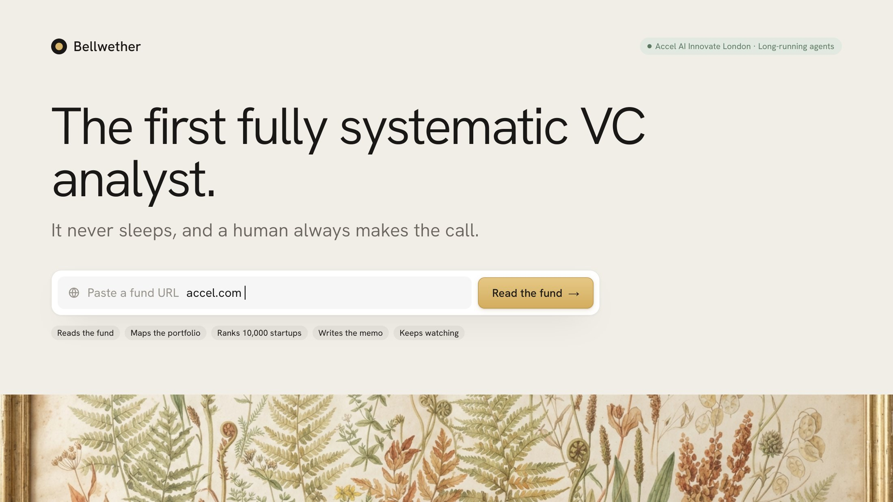
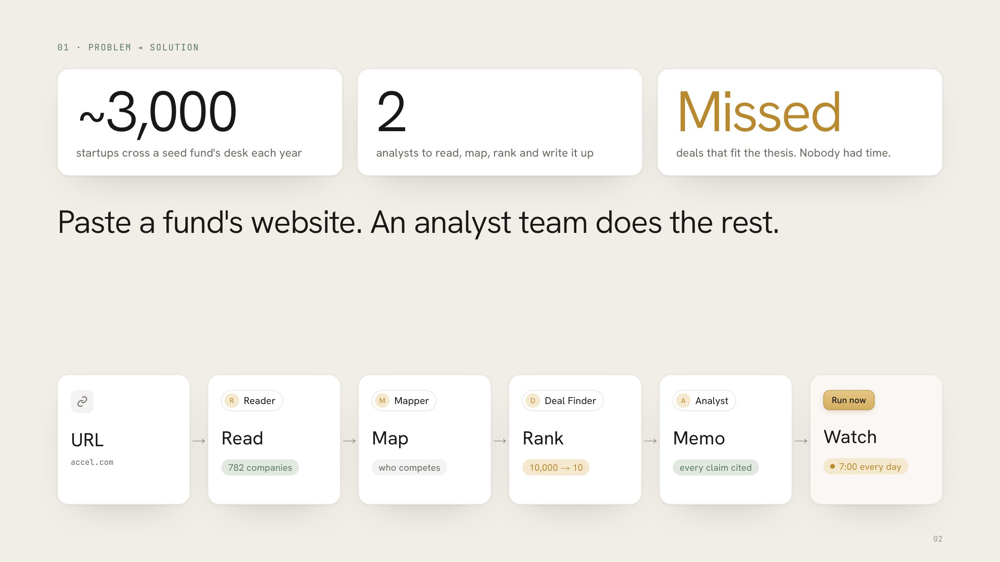
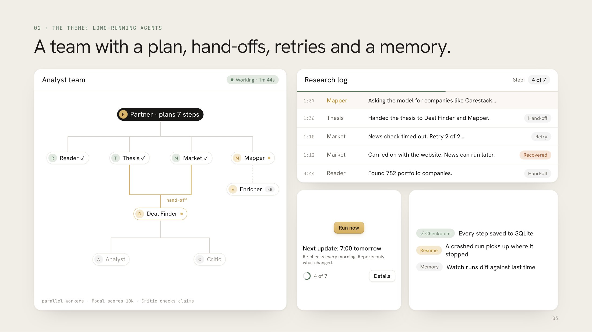
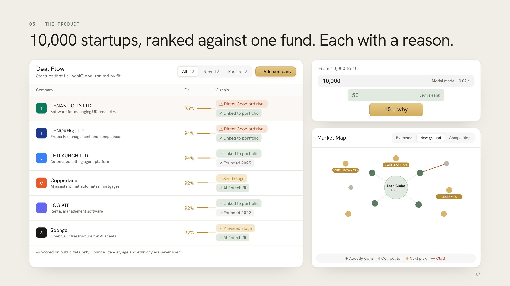
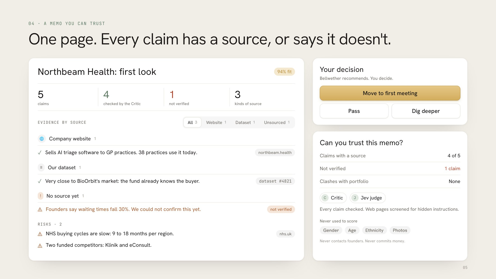
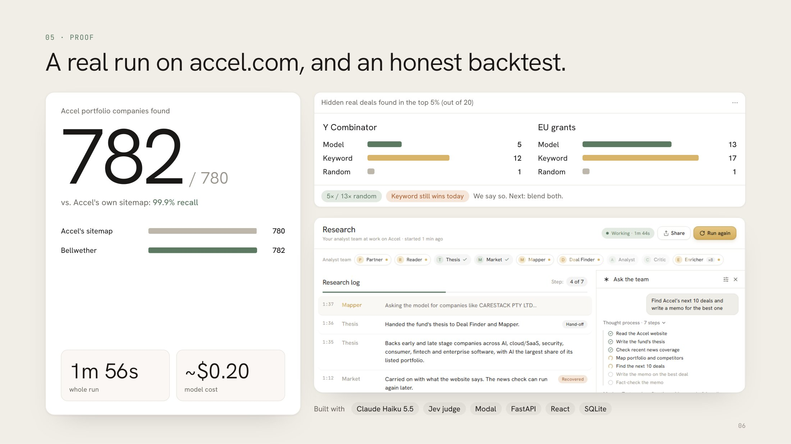

# Bellwether: the first systematic VC operating system

> Paste a fund's website. A team of AI agents learns what the fund invests in, maps its portfolio,
> predicts its next deals, and writes the due diligence. It keeps watching after that.

Built for the **Accel AI Innovate London** hackathon (theme: long-running agents) by
[@londrwus](https://github.com/londrwus) and [@abdullahsxd](https://github.com/abdullahsxd) (Abdullah Saeed).



## The problem (in one breath)

A VC fund sees thousands of startups a year and invests in about ten. Analysts spend most of their week on
the same manual loop: read news, search databases, compare companies to the portfolio, write memos.
Good deals get missed because nobody had time to look.



## What Bellwether does

| Step | What you see | Who does it |
|---|---|---|
| 1. Learn the fund | A short "fund DNA" card: sectors, stage, geography, check size, signals | Fund Reader + Thesis agents |
| 2. Map the portfolio | A node map: portfolio companies, their competitors, white space | Mapper agent |
| 3. Predict next deals | A ranked shortlist with a match score and a plain-English "why" | Deal Finder agent + ML model on Modal |
| 4. Do the diligence | A one-page memo with sources, risks and questions for the founder | Analyst + Critic agents |
| 5. Keep watching | Daily re-runs that flag what changed | Scheduler + memory |

A human partner approves every decision. Bellwether never contacts founders by itself.

### A team of long-running agents

A partner agent plans the run and hands work to the others. Every step is saved, failed steps retry,
and a crashed run picks up where it stopped.



### 10,000 startups, ranked against one fund



### A memo you can trust

Every claim has a source, or says it doesn't.



### Proof: a real run on accel.com



## Who it's for

Seed and Series A VC funds, angel syndicates, and corporate VC teams. Small funds get the most from it:
they have the fewest analysts.

## Stack

FastAPI (Python) · Claude agents (Opus orchestrator, Sonnet workers) · Modal (embeddings + scoring) ·
Vite + React + Tailwind + shadcn/ui · React Flow for the node map.

## Run it

> Scaffolding not created yet. See `docs/PLAN.md` and `docs/TASKS.md`.

```bash
# backend
cd backend && uv sync && uv run fastapi dev app/main.py
# frontend
cd frontend && npm install && npm run dev
# ml
cd ml && modal deploy modal_app.py
```

Set `DEMO_MODE=replay` to play back a recorded run if the network fails during the demo.

## Team

Made by [@londrwus](https://github.com/londrwus) and [Abdullah Saeed (@abdullahsxd)](https://github.com/abdullahsxd).

## Docs

Start with [`CLAUDE.md`](CLAUDE.md), then [`docs/`](docs/).
